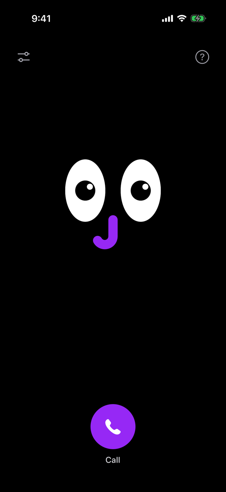

# OjO

OjO is a phone call with an AI friend who can see your iPhone screen. It helps you through apps you cannot read: it tells you
where to tap, shows the place in a small window and writes text for you in the local language.

<p align="center">
  
</p>

## A call

1. Tap Call. OjO asks how it can help.
2. Share your screen in the system sheet that opens.
3. Go to the app you need. The call comes with you as a small window with OjO's eyes.
4. Say what you want, in your own words. OjO looks at your screen and answers by voice. If the answer depends on something, it
   asks.
5. When there is a place to tap, the window shows that part of your screen up close, with the place outlined.
6. When a field needs text, OjO writes it in the language of the app and puts it on the clipboard. You paste it.
7. You do all the tapping. OjO never taps, types or pays for you.
8. Before a password or a card, say "Don't look". Say "Look" to go on.
9. End the call, and the server forgets it.

## Models

Apart from a greeting and a few short waiting phrases, every word OjO says comes from Meta models. The server calls them
through the Meta Model API.

- **Muse Voice Transcribe 1.0** listens. One streaming session runs for the whole call and finds where each phrase ends.
- **Muse Wonder 1.0** thinks. On every turn it reads the conversation and the latest screens, and answers with one JSON
  object: what to say, what to outline and what text to paste.
- **SAM 3.1** finds the exact pixels of the place when the words on the screen are not enough, for example an icon without
  a label.
- **Muse Spark 1.3** runs Turbo calls, which answer faster. On a normal call it starts beside Wonder when Wonder has no line
  after 8 seconds.
- **ElevenLabs** gives OjO its voice: it reads the lines aloud. Without an ElevenLabs key the phone reads them in its own
  system voice.

Vision models name the right button but often miss its pixels. So the model copies the words of the place it means, and
the server looks for them: first in the text the phone reads off the screen, then with SAM by a short name, then among the
icons SAM finds near the model's rough box, and only then in the model's own box. On our bench of 40 tasks on 8 real app
screens, each run 3 times, Muse Wonder alone hit the right place 78 times out of 120. With text recognition and SAM 3.1 it
hit 109 times. We tuned that order on the same tasks, so read 109 as a tuned result, not a score on new screens.

Muse Code was not on the call. It reviewed our code while we built it, and several fixes in the history come from its notes.

## Your data

- Your screen, only while you share it, and your voice go to your OjO server and from there to Meta's models. The server
  uses the standard models, not the Contributor ones that may learn from the data.
- The text of OjO's lines goes to ElevenLabs for the voice. ElevenLabs never gets the screen.
- Text OjO writes for you goes to your iPhone's clipboard.
- Nothing is kept after the call. A call lives in the server's memory. When it ends, the server erases what was said and
  shown. If the app closes without ending the call, the server erases it after an hour.
- The server's log lines are technical: no words, no screens and no phone address.
- Say "Don't look", and OjO's eyes close: the phone stops sending your screen until you say "Look". The screen at the
  moment you say it still goes with your words, so say it before you open a password or a card.
- OjO never asks for a password, a PIN or a card number.
- Every request of a call needs the token that the server and the app share.
- One setting keeps more: `CALLS_DIR`. With it the server writes a private log of every call for debugging, without
  payment and password screens. Leave it empty, and nothing is kept.
- Meta and ElevenLabs handle what they get under their own terms.

The page [callojo.app/privacy](https://callojo.app/privacy/) says the same for the service we run. Its source is in
[site/privacy](site/privacy/index.html), next to the rest of [the site](site).

## Run your own server

You need:

- a Meta Model API key;
- an ElevenLabs API key, if you want OjO's voice;
- a long random token that you make up, for the server and the app;
- Python 3.9 to 3.14;
- HTTPS in front of the server, from a proxy such as Caddy or from a tunnel. The app talks only to an HTTPS address.

```sh
cd backend
python3 -m venv .venv
.venv/bin/python -m pip install -r requirements.txt
export META_API_KEY='your Meta key'
export ELEVENLABS_API_KEY='your ElevenLabs key'
export SHARED_TOKEN='your long random token'
.venv/bin/uvicorn app.server:app --host 127.0.0.1 --port 8000 --workers 1 --no-access-log
```

Keep one worker: calls live in memory. Point the HTTPS proxy at port 8000. `GET /health` needs no token and answers
`{"ok":true}`.

The server takes its keys only from the environment and never reads a `.env` file. The models and the other settings have
defaults, listed in [backend/README.md](backend/README.md).

Tests make no real requests to Meta or ElevenLabs:

```sh
.venv/bin/python -m pip install pytest httpx
.venv/bin/python -m pytest tests -q
```

## Build the app

You need a Mac with Xcode (we use 27.1), [XcodeGen](https://github.com/yonaskolb/XcodeGen), an Apple developer account and
an iPhone with iOS 17 or later.

1. Copy `ios/Config/Local.xcconfig.example` to `ios/Config/Local.xcconfig` and fill it in: your bundle identifier, an App
   Group, your team ID, the address of your server and the same token as `SHARED_TOKEN`. `Local.xcconfig` stays out of git.
2. Generate the project and open it:

   ```sh
   cd ios
   xcodegen generate
   open App.xcodeproj
   ```

3. Choose your iPhone and run the `App` scheme. Xcode signs the app and its broadcast extension with your team. Both use the
   App Group. If Xcode cannot create it, add it in your developer account for both identifiers.

The network checks need no server and no iPhone: `sh ios/scripts/check-protocol.sh`. `ios/scripts/archive.sh` makes a
build for TestFlight. More in [ios/README.md](ios/README.md).

## Limits

- OjO works only on the iPhone. There is no Android app.
- The small window is the system's Picture in Picture. It plays a video of OjO's eyes and the outline. If it does not open,
  turn on Settings › General › Picture in Picture › Start PiP Automatically.
- While a call is on, the app plays a quiet sound in the background. It keeps the call alive when you switch to another
  app, the way a calling app keeps its line open.
- The screen goes out through the system's screen broadcast. You start it yourself, and iOS shows that the screen is shared.
- OjO can point at the wrong place. Look before you tap.
- An answer takes a few seconds. Turbo answers faster with a lighter model.
- OjO talks in your phone's language, or in English if you choose it in the settings. Its own buttons and phrases are in
  English, Russian and Spanish. It reads screens in any language.
- We tested it on one iPhone with iOS 27, in Tokopedia, Discord, LOKET X and Baidu Maps, through the speaker and through
  AirPods. The iPhone Simulator shows neither the small window nor the broadcast.
- You need your own server and keys, and Meta and ElevenLabs charge for what a call uses.
- The bench in [backend/eval](backend/eval) needs screenshots of real apps. They are not here, because they show personal
  data.

## License

[MIT](LICENSE), copyright 2026 cveti69. The Inter font in `backend/assets` is under the
[SIL Open Font License](backend/assets/Inter-LICENSE.txt).

OjO was made for the Meta Global AI Developer Hackathon, Indie Developer track.
