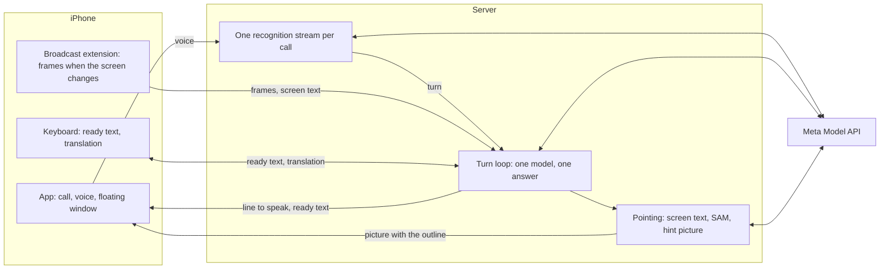

# OjO

A phone call with an AI friend who can see your screen.

You are in a country whose apps you cannot read. You call the agent and talk to it the way you would talk to a friend who knows the
place. You share your screen, go to the app, and the call shrinks into a floating window. The agent looks at what you look at, says
what it finds, and asks the one thing that changes the answer. Ask where to tap, and the window shows your own screen zoomed in on
that button, with the button circled. When a field needs text, a ready phrase in the local language is waiting for you.

The agent never taps for you. It never asks for a PIN, a password or a card number, and only you confirm a payment.

Built for the Meta Global AI Developer Hackathon, Indie Developer track, Build for Your World.

## How it works



The phone captures the screen, plays the voice, shows the window and inserts text. All understanding and all decisions happen on the
server, on Meta models.

There is one loop. A turn is something the person said or a new settled screen, and one model answers the whole turn with one JSON
object:

| Field | Meaning |
|---|---|
| `say` | The line to speak. It can be empty: the agent may just keep watching. |
| `show` | What to outline: the text of that spot, a short English name, and a rough box. |
| `paste` | Ready text for a field. |
| `private` | The screen shows a payment, a card, a password or a code. |
| `lang` | The language of the app on the screen. |
| `notes` | Notes to itself, which come back on the next turn. |

There is no script around the model: no modes, no goal, no task list, no scenarios. Its instructions hold a short role, the
prohibitions and this format, so the agent decides by itself when to speak, what to compare and what to ask.

Each Meta model has one job:

- **Muse Wonder 1.0** thinks for the whole call. On every turn it reads the conversation and the last 4 different screens.
- **Muse Voice Transcribe 1.0** listens through one streaming session for the whole call and finds where each phrase ends.
- **SAM 3.1** finds the exact pixels when the words on the screen do not settle it.
- **Muse Spark 1.3** starts beside Wonder when Wonder has no line in 8 seconds, and translates text in the keyboard.
- **Muse Code** reviewed our code as an independent second reader. Its findings are behind many of the fixes in the history.

ElevenLabs reads the agent's lines aloud. Every line comes from Meta models. The only fixed text is the greeting and a few short
waiting phrases, which fill the pause if there is no answer after 1.5 seconds.

## Details that took measuring

**The voice starts before the answer ends.** The answer is streamed with `say` first, so the line goes to the voice as soon as it is
whole. In 11 turns on the real server the line came 517 ms before the end of the answer at the median, 376 ms at the least. Whether a
screen is private is known only from the whole answer, so nothing about a screen is written down until then.

**A new screen, or just a video?** A frame is a new turn when at least 38% of a thumbnail changed since the last turn. On a real call a
looping video reached 37%, the keyboard 33%, and a real new screen 40% or more. Replaying a real call of 14 frames over a looping
video, the agent spoke 0 times without being asked.

**A wrong circle is worse than no circle.** General vision models name the right element but miss its pixels. So the model copies the
words of the place it means, and the outline finds them with on-device text recognition first, then SAM by the short name the model
gave, then an icon SAM finds next to the model's rough box, and the model's own box last. We measured this on the current call: 40 tasks
on 8 real app screens, each run 3 times. A hit means the centre of the box lands inside the correct element.

| Method | All | Scenario steps | Icons |
|---|---:|---:|---:|
| Muse Wonder 1.0 alone | 78 of 120 | 19 of 24 | 27 of 51 |
| With text recognition and SAM 3.1 | **109 of 120** | **21 of 24** | **43 of 51** |

Both rows come from the same answers. We chose the search order and the instruction to copy the words on these same 40 tasks, so read
the second row as the tuned result, not as a score on new screens.

The bench is in [backend/eval](backend/eval). Its screenshots are not in this repository, because they show personal data.

**Our own window is on the screen too.** The server finds it by its coloured border and paints it grey before the model sees the frame,
so the words under it do not count and its changing picture is not a new screen.

## Repository

| Path | What is inside |
|---|---|
| [ios](ios) | The app, the broadcast extension and the keyboard. Generated with XcodeGen. |
| [backend/app](backend/app) | The FastAPI server, the call loop and the Meta client. |
| [backend/eval](backend/eval) | The accuracy bench and its report page. |
| [docs/protocol.md](docs/protocol.md) | The contract between the phone and the server. |

## Running it

Server, Python 3.9 or later:

```bash
cd backend
python3 -m venv .venv
.venv/bin/python -m pip install -r requirements.txt
export SHARED_TOKEN=choose-a-token
export META_API_KEY=your-key
export META_TEXT_MODEL=muse-spark-1.3
export ELEVENLABS_API_KEY=your-key
.venv/bin/uvicorn app.server:app --port 8000
```

More in [backend/README.md](backend/README.md).

App: set your team, identifiers and server address in `ios/Config/Project.xcconfig`, then:

```bash
cd ios
xcodegen generate
open App.xcodeproj
```

Screen broadcast, the floating window and the keyboard need a real iPhone. The interface and the agent's role are in Russian for now.
More in [ios/README.md](ios/README.md).

## Privacy

Nothing from a call is written to disk unless the server is started with `CALLS_DIR`, a private folder for debugging calls. Payment
and password screens stay out of it even then: the model says so, and a broad list of words in Russian, English and Indonesian catches
what the model misses. Sessions live in memory, and requests need a shared token. Frames go only to Meta's standard models, not to the
Contributor models that allow training on data. ElevenLabs gets the text of the agent's lines, never the screen.

## License

[MIT](LICENSE). The bundled Inter font is under the [SIL Open Font License](backend/assets/Inter-LICENSE.txt).
