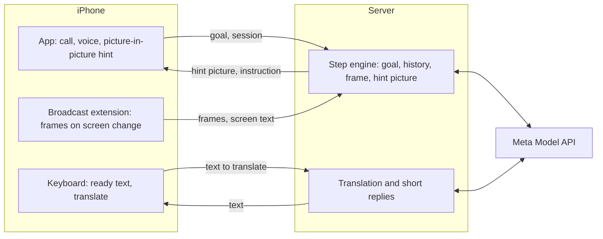

# OjO

A phone call with an AI guide that can see your screen.

You are in a country whose apps you cannot read. You call the agent and say what you need in your own language. You share your
screen, go to the app, and the call shrinks into a floating window. Instead of a face, the window shows your own screen zoomed in
on the next button, with that button circled. The agent says the step out loud. When a field needs text, a ready phrase in the
local language is waiting for you.

The agent never taps for you. It never asks for a PIN, a password or a card number, and it stops at payment so you can check the
amount and confirm yourself.

Built for the Meta Global AI Developer Hackathon, Indie Developer track, Build for Your World.

## How it works



The phone only captures the screen, shows hints and inserts text. All understanding and decisions happen on the server, on Meta
models.

For each new screen the server does this:

1. Asks **Muse Spark 1.3** for the next step as strict JSON, with the frame, the goal and the steps so far.
2. At the same moment asks **SAM 3.1** for every icon on the frame.
3. Picks the exact target: the words from on-device text recognition if the target has text, otherwise the icon nearest to the
   model's rough location, otherwise SAM by the short name the model gave, otherwise the model's own box.
4. Draws a 720×960 hint picture and sends it to the phone, which shows it in the floating window and speaks the instruction.

**Muse Voice Transcribe 1.0** turns the spoken goal into text.

## Why the extra step

General vision models name the right element but miss its pixels, and a wrong circle is worse than no circle. We measured this on
40 tasks on 8 real app screens, each run 3 times. A hit means the centre of the box lands inside the correct element.

| Method | All | Scenario steps | Icons |
|---|---:|---:|---:|
| Muse Spark 1.3 alone | 68 of 120 | 16 of 24 | 24 of 51 |
| With text recognition and SAM 3.1 | **111 of 120** | **22 of 24** | **46 of 51** |

Repeat runs of the pipeline landed between 107 and 111. The median time for one step stayed at about 3 seconds, because SAM runs
next to the model and not after it. The bench is in [backend/eval](backend/eval). Its screenshots are not in this repository,
because they show personal data.

We also drew our floating window over the same screens and ran the tasks again. The agent never pointed at its own window, and
when the window hid the button it needed in the order, it asked to drag the window aside.

## Repository

| Path | What is inside |
|---|---|
| [ios](ios) | The app, the broadcast extension and the keyboard. Generated with XcodeGen. |
| [backend/app](backend/app) | The FastAPI server, the step engine and the Meta client. |
| [backend/eval](backend/eval) | The accuracy bench and its report page. |
| [docs/protocol.md](docs/protocol.md) | The contract between the phone and the server. |

## Running it

Server, Python 3.9 or later:

```bash
cd backend
python3 -m venv .venv
.venv/bin/python -m pip install -r requirements.txt
export SHARED_TOKEN=choose-a-token
export META_API_KEY=your-key
export META_VISION_MODEL=muse-spark-1.3
export META_TEXT_MODEL=muse-spark-1.3
.venv/bin/uvicorn app.server:app --port 8000
```

App: set your team, identifiers and server address in `ios/Config/Project.xcconfig`, then:

```bash
cd ios
xcodegen generate
open App.xcodeproj
```

Screen broadcast, picture-in-picture and the keyboard need a real iPhone.

## Privacy

Frames are not written to disk unless the server is started with `SAVE_FRAMES=1`. Sessions live in memory. Requests need a shared
token. The server uses Meta's standard models, not the Contributor models that allow training on data.

## License

[MIT](LICENSE). The bundled Inter font is under the [SIL Open Font License](backend/assets/Inter-LICENSE.txt).
